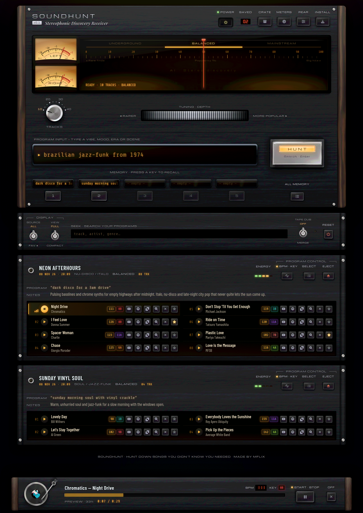
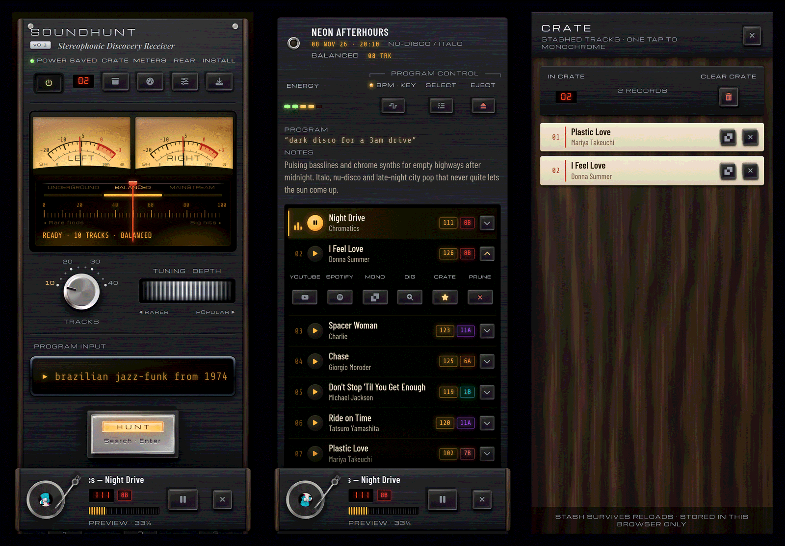
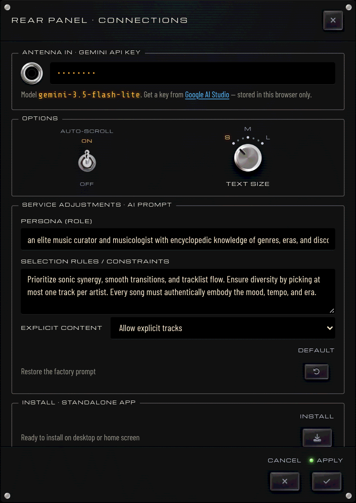

# SoundHunt

> **Hunt down songs you didn't know you needed.**

**SoundHunt** finds music from a plain-language description. Type any vibe, era, scene or genre and it tunes in a program of real tracks, previews them on a turntable, detects their BPM and harmonic key right in your browser, and keeps the ones you love in a crate. It's all built into a 1970s-style hi-fi receiver, the *SH-1977*.



<div align="center">

<h2>🔑 Free Gemini API Key Needed &bull; <a href="https://aistudio.google.com/apikey" target="_blank" rel="noopener noreferrer">Google AI Studio</a></h2>

<a href="https://sound-hunt.vercel.app" target="_blank" rel="noopener noreferrer">
  
</a>

<p><em>(Works on Windows, Mac, Linux &amp; mobile • 1-click install as a standalone app)</em></p>

</div>

---

## What Can SoundHunt Do?

### Tune in
- **Natural-language discovery**: describe any era, subgenre or mood in any language (*"90s underground progressive house"*, *"wedding dance-floor classics"*, *"songs that sound like a rainy Tokyo night"*). No genre dropdowns, no algorithmic echo chamber.
- **Tuning depth**: spin the flywheel to move the dial between **Underground** (rare B-sides and deep cuts), **Balanced** and **Mainstream** (the classics everyone knows).
- **Tracks knob**: choose 10, 20, 30 or 40 tracks per program.
- **Memory presets**: your last five prompts sit on preset keys, and **ALL MEMORY** recalls the rest.

### Listen & analyze
- **Turntable preview**: play a 30-second preview of any track. The VU meters swing along, and you can drag the platter to scratch.
- **BPM & Camelot key detection**: tempo and harmonic key are worked out in your browser and shown as colour-coded Camelot tags (`1A`–`12B`), ready for mixing.
- **Fine Tune**: found a track you love? Dig for 3, 5, 10 or a custom number of tracks that share its groove, era and energy. They're added right after it in the program.
- **Straight to your services**: open any track on **YouTube**, **Spotify** or **[Monochrome](https://monochrome.tf)**.

### Keep & organize
- **Crate**: star tracks (`★`) into a persistent crate, then hop to Monochrome from there in one tap.
- **Tape Dub**: merge several programs into one, with duplicates filtered out.
- **Select, prune & eject**: pick several tracks to delete at once, remove single tracks with `✕`, or eject a whole program.
- **Seek, favourites & compact view**: search across programs, tracks and artists, light a program's lamp to favourite it, and switch to a compact view where each program opens in place.
- **Meters**: a discovery log with counters for programs, tracks, favourites and crate, plus your top artist, genre and program and an estimated listening time.

### Everywhere
- **Phone and desktop**: the same receiver on both. On phone, each track's fold-out key opens its actions, and tapping a title copies *Artist - Title*.
- **Standalone app**: install SoundHunt from the browser on **Windows, macOS, Linux** or your phone's home screen. The receiver and your saved programs open offline too (previews still need a connection).



---

## Quick Start

### Option A: Launch Instantly in Browser or Desktop
1. Open the live app: **[SoundHunt on Vercel](https://sound-hunt.vercel.app)**.
2. Press **POWER**. Like the real thing, nothing works until the receiver is on.
3. To install it as a standalone app on **Windows, macOS or Linux**, press **INSTALL** on the receiver's top strip (or the ⊕ icon in your browser's address bar).

---

### Option B: Run Locally with Python
If you'd rather run SoundHunt yourself or tinker with the source (it's a plain static site, no build step):
```bash
git clone https://github.com/marceloflix/SoundHunt.git soundhunt
cd soundhunt
python3 server.py
```
Open **`http://localhost:8080`** in your browser.

---

### Setup: Grab Your Free Gemini Key
SoundHunt uses Google's Gemini API (`gemini-3.5-flash-lite`) to understand your musical prompts:
1. Head over to [Google AI Studio](https://aistudio.google.com/apikey).
2. Sign in and click **Create API Key**.
3. In SoundHunt, press **REAR** to open the rear panel, plug the key into **Antenna in**, and press apply. You're ready to hunt!

*(Your key is saved only in your browser's local storage, and SoundHunt sends it nowhere except Google's Gemini API.)*

The rear panel is also where you set text size and auto-scroll, fine-tune the AI prompt, and run a factory reset that keeps your key.

<p align="center"></p>

---

## License

Distributed under the **MIT License**. Made for music lovers.
